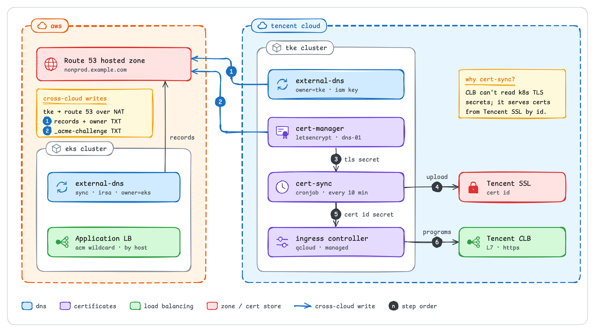

# bb-excalidraw

A Claude Code skill for BackendByte-style hand-drawn diagrams. You describe a system or flow, and Claude writes a small spec, lints the layout, and renders:

- **SVG**: sketchy rough.js strokes with the Comic Shanns font embedded, ready for the blog
- **.excalidraw**: native, editable Excalidraw elements
- **PNG**: a 2× preview through headless Chrome



## Install
```bash
git clone https://github.com/sagoresarker/bb-excalidraw-skills.git && cd bb-excalidraw-skills
cd bb-excalidraw && npm i && cd ..
ln -s "$PWD/bb-excalidraw" ~/.claude/skills/bb-excalidraw
```
You need Node 18+, plus Google Chrome or Chromium for the PNG preview (set `CHROME=/path` if it isn't auto-detected).

## Use
In Claude Code, ask something like *"draw an excalidraw diagram of a request going CDN → LB → two app servers → postgres"*. The skill triggers on its own, or you can invoke `/bb-excalidraw`.

Manual use:
```bash
bash bb-excalidraw/scripts/render.sh bb-excalidraw/examples/03-node-lost-workflow.js out/
node bb-excalidraw/scripts/lint.js my-spec.js --strict
node bb-excalidraw/scripts/import-lib.js aws.excalidrawlib --pack aws   # then use icon: "aws:<name>"
```

## Layout
```
bb-excalidraw/
  SKILL.md          workflow + house style (what Claude reads)
  scripts/          bbdiagram.js (renderer) · lint.js · render.sh · import-lib.js
  references/       spec reference · style guide · layout recipes · libraries
  examples/         7 specs + PNGs
  icons/            imported library icon packs
  assets/           Comic Shanns font
bbdiagram/, samples/   original source material
```
